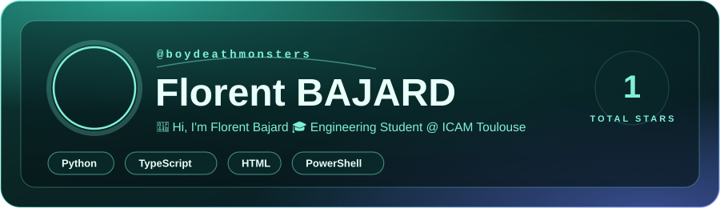
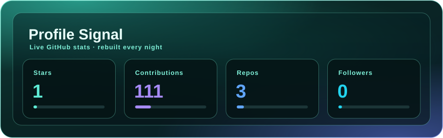
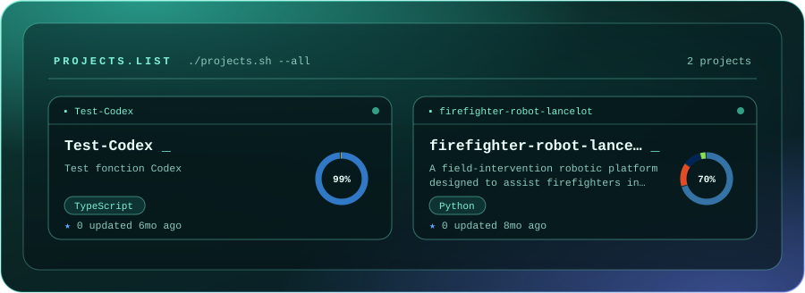
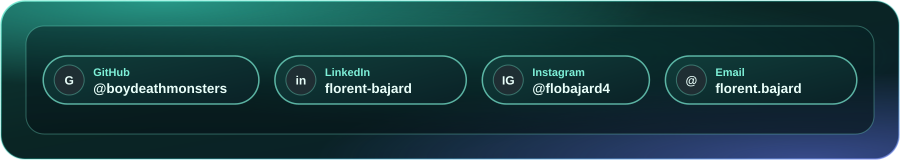

  

## The city I built this year

  

Every building is a day; taller means more contributions.

## Population

  

## Landmarks

  

## Visit

  

  <a href="https://github.com/BoyDeathMonsters">GitHub</a> ·
  <a href="https://www.linkedin.com/in/florent-bajard">LinkedIn</a> ·
  <a href="https://instagram.com/flobajard4">Instagram</a> ·
  <a href="mailto:florent.bajard@2028.icam.fr">Email</a>

Cards rebuilt every night by <code>scripts/build_profile.py</code>

