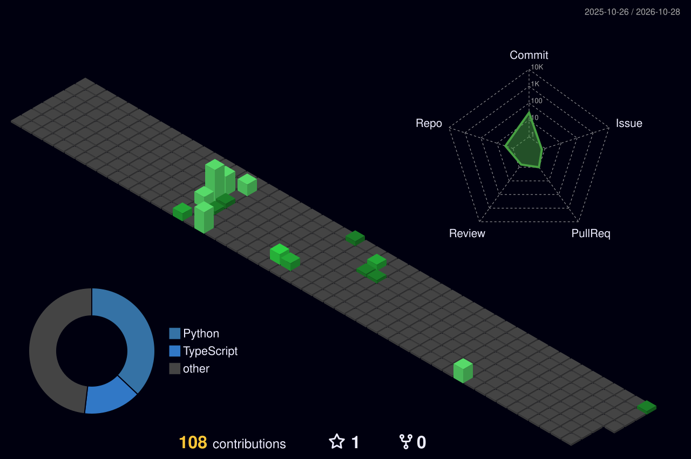

<!-- ═══════════════════ HEADER ═══════════════════ -->

  

  

  
  

  

---

## The city I built this year

  

Every building is a day — taller means more contributions. Rebuilt every night by a GitHub Action.

---

## Population

  
  

  

---

## Landmarks

  
  

---

## Visit

  
  
  
  

<!-- ═══════════════════ FOOTER ═══════════════════ -->

  

